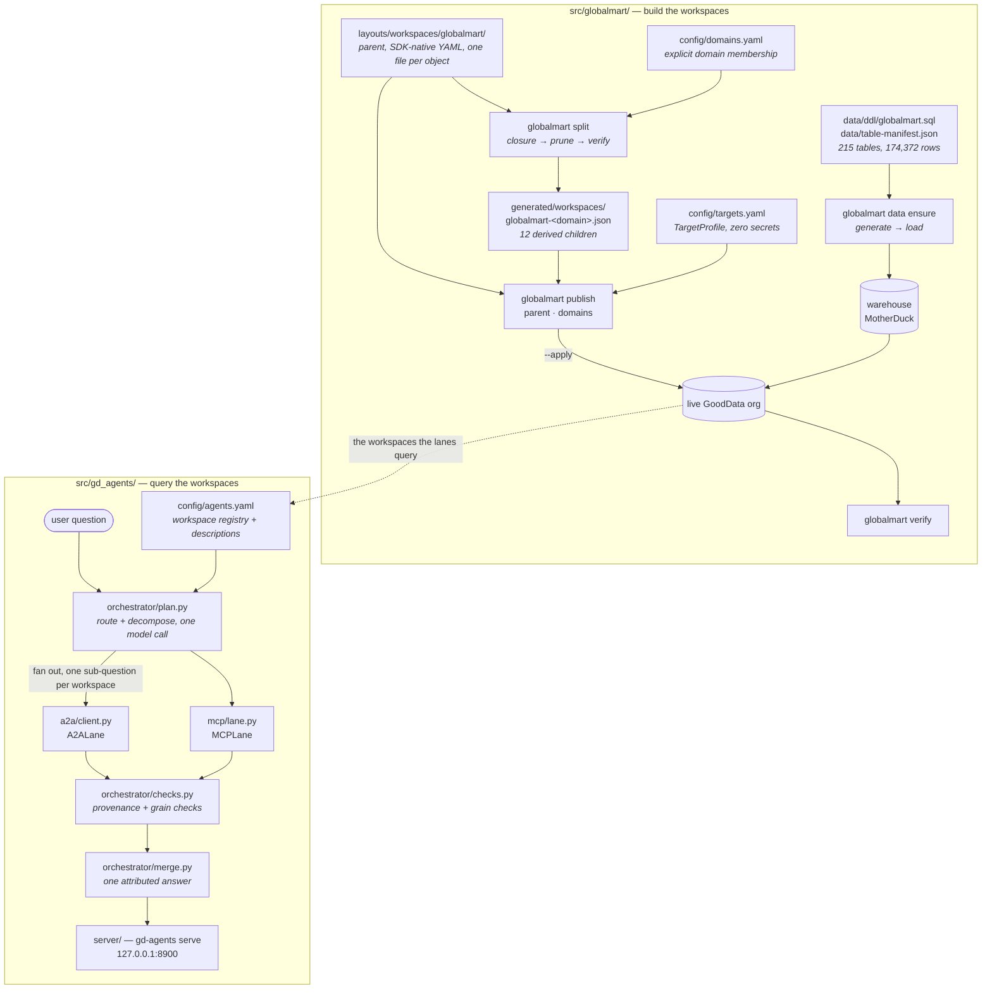

# GlobalMart

A complete GoodData retail analytics estate — warehouse rows, logical data model, 1091 metrics,
384 visualizations, 32 dashboards and the AI context on top — defined as code and rebuildable into
any org from a clean clone.

**The repo is the source of truth, never a live org.** Nothing here requires reading a live
workspace to rebuild GlobalMart. Two packages, two jobs: `src/globalmart/` builds the workspaces,
`src/gd_agents/` talks to them.

[Vision](specs/VISION.md) · [Feature specs](specs/) ·
[Steering constraints](specs/STEERING.md) · [Interface contract](specs/CONTRACT.md)

## Why it exists

- **[goal-01](specs/goals/goal-01.md) — rebuildable from source into any domain.** A clean clone
  plus credentials for an empty org rebuilds the parent workspace and all 12 domain workspaces,
  every visualization executing, no manual step.
- **[goal-02](specs/goals/goal-02.md) — A2A and MCP shown to be implementable over it.** The 12
  domain workspaces each have their own pruned model and metric vocabulary, so choosing between
  them is a real semantic routing decision — which makes them the proving ground for an
  orchestrator that federates across workspaces it does not own.

## How it fits together



## Map of the repo

| Path | What | Committed? |
|---|---|---|
| [`layouts/workspaces/globalmart/`](layouts/workspaces/globalmart) | Parent workspace, SDK-native YAML, one file per object. No org id in the path | yes |
| [`generated/workspaces/`](generated/workspaces) | The 12 derived children, declarative JSON. Derived, never authored — fix the parent and regenerate. Local-only: deployed on demand, never released ([ADR 011](specs/decisions/011-gdcloud-release-of-globalmart.md)) | yes ([ADR 003](specs/decisions/003-generated-artifacts-committed-vs-regenerated.md)) |
| [`data/`](data) | `ddl/globalmart.sql` (215 tables) and `table-manifest.json`. The rows themselves are generated on demand, not stored | DDL + manifest yes; rows no ([ADR 008](specs/decisions/008-data-generated-not-committed.md)) |
| [`config.yml`](config.yml) | gdcloud release config: one data product, four environments on two orgs | yes |
| [`gd_data_product/globalmart/`](gd_data_product/globalmart) | What gdcloud releases. Derived from the parent layout by `globalmart gdcloud project` — never edited | yes |
| [`gd_plugin/`](gd_plugin) | GlobalMart's own gd-ci checks (`org_scope`, `projection_current`) | yes |
| [`config/`](config) | `targets.yaml` (publish targets, zero secrets), `domains.yaml` (domain membership), `agents.yaml` (orchestrator registry), corpus manifests | yes |
| [`src/globalmart/`](src/globalmart) | Capture, normalize, split, publish, verify, data generation, knowledge compilation | yes |
| [`src/gd_agents/`](src/gd_agents) | The A2A/MCP orchestrator: registry, router, lanes, merge checks, viewer | yes |
| [`docs/`](docs) | How each part works, and what was measured | yes |
| [`specs/`](specs) | Vision, goals, steering, the interface contract, ADRs, per-feature specs | yes |
| [`tests/`](tests) | Test suite | yes |
| `backups/`, `reports/` | Runtime output | no |

## Rebuild GlobalMart into an org

```bash
uv sync --extra data

# 1. Credentials: a profile in config/targets.yaml, its token in the environment.
#    Tokens are env-only and never live in YAML.
export GLOBALMART_TOKEN__DEMO_CLOUD=...
globalmart targets inspect --target gdcloud-dev    # org id + datasources, read from the host

# 2. Check the committed artifacts before touching anything remote.
globalmart data verify                              # DDL agrees with the SQL datasets
globalmart split --check                            # generated/workspaces is current
globalmart domains validate --strict                # every dashboard lands in a domain

# 3. The whole chain, into an EMPTY org — rehearsal first. Without --apply nothing is written.
#    Over an org that already holds GlobalMart it aborts unless --allow-existing.
globalmart rebuild --target <fresh-org>
globalmart rebuild --target <fresh-org> --apply
```

`rebuild` is the cold-start proof: the steps below, then the knowledge corpus
(`--skip-knowledge-docs` to leave it out). It publishes all 12 domains, so it is not for the
shared orgs. Break it open when a step needs attention:

```bash
globalmart data ensure   --target <fresh-org> --apply   # generate rows, load the warehouse
globalmart publish parent  --target <fresh-org> --apply # the parent workspace
globalmart split                                        # derive the 12 children
globalmart publish domains --target <fresh-org> --apply # publish them
globalmart verify --target <fresh-org>                  # execute every visualization
```

`--apply` gates every write to a live org; `--dry-run` belongs to commands whose writes are local
files, and no command has both. Details: [publish targets](docs/publish-targets.md) ·
[verification](docs/verification.md) · [the data](docs/data-custody.md) ·
[the domain split](docs/domain-split.md).

Commands assume the venv is active (`source .venv/bin/activate`); otherwise prefix `uv run`.

## Keep the data current

The rows are generated, not stored (ADR 008), over a two-year window ending today. One MotherDuck
schema, `gd_demo.globalmart`, backs all four gdcloud environments.

```bash
globalmart data ensure --target gdcloud-dev --check   # read-only; exits 3 when a load is due
globalmart data ensure --target gdcloud-dev --apply   # generate + load only if empty or stale
globalmart data ensure --target gdcloud-dev --apply --force   # regenerate anyway
```

`data-currency.yml` runs it weekly (or *Actions → Run workflow*, with force + apply after a
`config/vocabulary.yaml` change); CI fails a PR once the data is more than 45 days old.

## Release GlobalMart (gdcloud)

The parent workspace is released by [gdcloud](https://github.com/gooddata/gd-cloud-tooling), the
same toolkit and process as gd-ecommerce-demo on the same orgs ([ADR 011](specs/decisions/011-gdcloud-release-of-globalmart.md)):
one data product, `globalmart`, promoted by version tag through four environments.

| Env | Org | Workspace | Deployed by | GitHub Environment |
|---|---|---|---|---|
| dev | petertomko.demo.cloud | `globalmart_dev` | workflow 3, on merge of a `GM`-labelled PR | `develop` |
| test | petertomko.demo.cloud | `globalmart_test` | workflow 4, manual | `staging` |
| preprod | usecases-ai.demo.cloud | `globalmart_preprod` | workflow 5, manual | `preprod` |
| prod | usecases-ai.demo.cloud | `globalmart_master` | workflow 5, after approval | `production` |

```
edit layouts/workspaces/globalmart/ ─► globalmart split ─► globalmart gdcloud project ─► PR (label GM)
   CI: split/project --check, warehouse current, gdcloud gates ─► merge ─► v1.N ─► dev
   ─► workflow 4 ─► test ─► workflow 5 (preprod) ─► workflow 5 again (prod, approval)
   after every deploy: globalmart_post_deploy publishes + verifies the knowledge corpus there
```

```bash
make project            # regenerate gd_data_product/globalmart/ after a parent change; commit both
make project-check      # what CI checks
make ci                 # gdcloud's offline gates, plus ours
```

- **The default branch is `master`**; PRs target it.
- **Labels decide what ships.** `GM` deploys the data product; `TOOLING` (docs, CI, code) deploys
  nothing. A PR that changes `gd_data_product/` without `GM` cannot merge.
- **Promote** with *Actions → 4 / 5 → Run workflow*. Leave the version empty for the latest, or name
  one (`v1.4`) to roll back. **Hotfix** a prod defect with `gd-hotfix`, which cuts `hotfix/*` from
  the last prod release and ships `v1.N.1`.
- **Never edit `gd_data_product/globalmart/`** — it is derived. Change the layout and re-project;
  `projection_current` fails the build otherwise.
- **Org-level objects** (agents, themes, org-level AI Knowledge documents) are not released, read or
  written from this repo: both orgs are shared, and a separate org repo owns them (gd-ecommerce-demo
  ADR 002). The knowledge corpus goes into workspaces only. `org_scope` enforces it. That repo does
  not exist yet; org changes made by hand are recorded in [org-repo-handoff.md](docs/org-repo-handoff.md).
- **The 12 domain workspaces are local-only** — derived, gated, never released. The exception is the
  4 the orchestrator reads, deployed on usecases-ai. Deploy any on demand with `--only`:
  `globalmart publish domains --target usecases-ai --only customer,marketing,store_ops,ecommerce --apply`,
  then `globalmart knowledge-docs publish --target usecases-ai --workspace-id <id> --apply` for each.
- First deploy to a new org: `globalmart gdcloud bootstrap --environment <env>` (rehearsal, then
  `--apply`) checks the workspace cap, creates the data source and the titled master.

## Run the orchestrator

One GoodData agent is scoped to one workspace. Every customer with more than one hits that wall, so
`gd-agents` federates: route the question, fan out to the workspaces that can answer it, merge one
attributed answer. Same questions run over A2A or MCP, which is how the two are compared rather
than argued about. It reads 4 domain workspaces on usecases-ai, already deployed; the committed
`config/agents.yaml` points there.

```bash
uv sync --extra agents
export GLOBALMART_TOKEN__USECASES_AI=...
export ANTHROPIC_API_KEY=...

# 1. Optional — only after the workspaces change. Re-describes them; overwrites config/agents.yaml.
gd-agents profile --host https://usecases-ai.demo.cloud.gooddata.com \
  --token-env GLOBALMART_TOKEN__USECASES_AI \
  --workspaces globalmart-customer,globalmart-marketing,globalmart-store-ops,globalmart-ecommerce \
  --apply

gd-agents registry                          # what the router sees

# 2. Score routing alone — no lane called, so it is cheap.
gd-agents route --script config/questions.yaml

# 3. Ask for real. 30–120s for a two-lane question: the lanes are live agents, not a cache.
gd-agents ask "which regions grew fastest last quarter, and did marketing spend follow?"
gd-agents ask "..." --protocol mcp          # same question, other protocol

# 4. Watch a turn happen.
gd-agents serve                             # http://127.0.0.1:8900
```

`gd-agents rehearse` replays the scripted conversations end to end against the live agents;
`mcp-probe` and `mcp-tools` measure what a workspace's MCP endpoint offers. The design and the
measured results are in [A2A federation](docs/a2a-federation.md); what an orchestrator still needs
from GoodData is in [the gap list](docs/a2a-gaps.md).

## Read next

| Doc | What it covers |
|---|---|
| [a2a-federation.md](docs/a2a-federation.md) | The orchestrator's design, and what it measured |
| [a2a-gaps.md](docs/a2a-gaps.md) | What a third-party orchestrator needs from GoodData, and what is missing |
| [mcp-findings.md](docs/mcp-findings.md) | What the MCP endpoint offers, and what it costs |
| [domain-split.md](docs/domain-split.md) | How a child is derived: closure, the pull-in rule, LDM pruning |
| [domains.md](docs/domains.md) | The `config/domains.yaml` manifest, field by field |
| [publish-targets.md](docs/publish-targets.md) | Adding a target, and what publishing rewrites |
| [verification.md](docs/verification.md) | The cold-rebuild proof and the failure taxonomy |
| [data-custody.md](docs/data-custody.md) | Where the rows come from and how they are checked |
| [org-repo-handoff.md](docs/org-repo-handoff.md) | Org-level changes made by hand, for the org repo to adopt |
| [knowledge.md](docs/knowledge.md) | AI memory items and the knowledge corpus |
| [bootstrap-provenance.md](docs/bootstrap-provenance.md) | What the parent workspace contained at capture |
